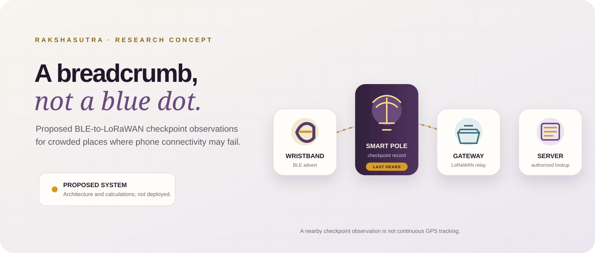

<div align="center">
  
  <h1>Rakshasutra · SurakshaNet</h1>
  <p><strong>A breadcrumb, not a blue dot.</strong><br>
  Research engineering for a proposed BLE-to-LoRaWAN checkpoint system.</p>
  <p>
    <a href="paper/rakshasutra_open.pdf">Read the supplied paper</a> ·
    <a href="docs/claim-audit.md">Claim-by-claim audit</a> ·
    <a href="docs/reproduction.md">Reproduce calculations</a>
  </p>
</div>

> [!IMPORTANT]
> **Evidence status:** This repository preserves an author-supplied manuscript and checks selected calculations. It contains no supplied raw field dataset, hardware logs, deployment record, or complete experimental protocol. The simulation is synthetic and assumption-driven. None of these materials establish field performance, safety, or deployment readiness.

## The idea, in one minute

A wristband broadcasts a short BLE identifier. A nearby smart pole may hear it and record a time-stamped checkpoint observation. A gateway relays compact pole messages to a server, where an authorized workflow could resolve the last known checkpoint.

**That is a last-heard checkpoint, not a live GPS location.** If no pole hears the band, or the route between poles is large, the system has a blind spot.

The proposal is motivated by crowded pilgrimage routes where cellular coverage or phone use may be limited. The repository examines whether selected claims and assumptions are internally consistent; it does not demonstrate that the proposed network works at a shrine.

## Start here

| If you want to… | Open |
|---|---|
| Understand the proposal | [Supplied paper PDF](paper/rakshasutra_open.pdf) |
| See which claims do and do not check out | [Selected claim audit](docs/claim-audit.md) |
| Rerun the calculations | [Reproduction guide](docs/reproduction.md) |
| Inspect the chosen synthetic workload | [Scenario inputs](configs/traffic_scenario.json) |
| See the full calculation inputs | [Claim inputs](configs/claims.json) |
| Browse every output | [Results](results/) · [Figures](figures/) |

A more visual project guide is in [docs/index.html](docs/index.html). The repository also includes a GitHub Pages workflow; publishing requires Pages to be enabled in repository settings.

## What is in this repository

- `paper/rakshasutra_open.pdf` — the supplied nine-page manuscript, preserved as the source under review.
- `simulation/audit.py` — standard-library Python calculations for LoRa airtime, pure-ALOHA loss, Bloom-filter false positives, BLE capture assumptions, pseudonym collisions, and idealized battery arithmetic.
- `simulation/traffic_simulation.py` — a separate single-cell synthetic packet-overlap simulation with deterministic seeds.
- `configs/` — transcribed paper values and explicit simulation assumptions.
- `results/` — generated CSV outputs, including per-run records for the synthetic traffic model.
- `figures/` — concept architecture and analytical or synthetic SVG plots.
- `docs/claim-audit.md` — claim-by-claim findings and questions that remain open.
- `docs/reproduction.md` — model definitions, exact commands, and output interpretation.

## Run the checks

Requires Python 3.10 or later. The scripts use only the Python standard library.

```bash
python simulation/audit.py
python simulation/traffic_simulation.py
```

The audit script rewrites selected CSVs in `results/` and analytical plots in `figures/`. The traffic script runs the scenario described in `configs/traffic_scenario.json` and writes its summary, run-level CSV, and plot. These commands do **not** reproduce a shrine deployment or the manuscript’s raw experiment traces.

## A careful reading of the numbers

### The manuscript's 3,000-tag ALOHA table

The manuscript lists offered load values of 0.390 for “single-event + raw heartbeat” and 0.086 for “25-tag chunk + 64 B Bloom.” Applying its stated pure-ALOHA equation, (P_{loss}=1-e^{-2G}), gives 54.2% and 15.8% packet loss, respectively.

Those two offered-load entries imply a **77.9% reduction in offered load**. The abstract separately says 82.4%; that difference needs reconciliation. The repository recomputes the formula from the paper’s (G) values; it does not independently derive or validate those offered loads.

### The repository's separate synthetic schedule

The event simulation produces a different lesson under its own configured assumptions:

| One-hour, 3,000-tag scenario | Mean simulated packet loss |
|---|---:|
| Single arrivals + raw per-pole heartbeat | 56.7% |
| 15-second batch windows + 64-byte heartbeat | 72.8% |

The batched case sends fewer packets, but this schedule emits them in narrow periodic windows. In this synthetic model, clustering increases overlaps. The 2.5th–97.5th percentiles describe run-to-run variation across 40 deterministic seeds, **not** uncertainty in the assumptions or measured shrine traffic. This is a schedule-sensitivity illustration, not a prediction of field performance.

### Other checks and limits

- **BLE vehicle capture:** five opportunities require at least 64.1% independent reception probability per advertisement to reach the paper’s 99.4% aggregate claim. That per-ad probability is not measured in the supplied evidence.
- **Rotating identifier:** the 32-bit birthday estimate for 3,000 tags is about 0.105% chance of at least one collision in one set under a uniform-random model. That estimate is not a complete privacy or linkability analysis.
- **Battery arithmetic:** capacity/current estimates are ideal ceilings. They do not validate runtime under cold conditions, pulse loads, regulator losses, cutoff behavior, aging, or a real device duty cycle.
- **Capacitor pulse check:** an ideal 100 µF capacitor alone would drop 32 V while supplying 32 mA for 100 ms. The complete battery-plus-capacitor circuit needs a bench test.
- **Radio range:** a link-budget calculation is not an RF range test. Site geometry, body loss, antennas, crowding, interference, and equipment need measurement.

Use [the full audit](docs/claim-audit.md) before quoting any number from this repository.

## Repository map

```text
configs/       transcribed manuscript inputs and explicit scenario assumptions
docs/          project guide, claim audit, and reproduction instructions
figures/       concept architecture and generated plots
paper/         supplied PDF and checksum
results/       generated CSV outputs and per-run simulation data
simulation/    reproducible arithmetic audit and synthetic event simulation
```

## Safety, privacy, and intended use

This is an early research concept and calculation set. It is not a validated child-tracking product, medical device, emergency-response system, or safety-certified design. Do not rely on it for real-world safeguarding.

Any prototype or deployment requires informed consent and access-control design, privacy/legal review, security testing, RF and battery tests, venue approval, and supervised operational trials. Rotating identifiers alone do not establish anonymity, unlinkability, or compliance with privacy law.

## Citation

Jha, Raj. *Rakshasutra: A Privacy-Preserving, Edge-Filtered Hybrid BLE–LoRaWAN Architecture for Real-Time Crowd Localization in Cellular-Denied Mountain Pilgrimages*. Author-supplied preprint, October 2026, 9 pages.

This repository preserves the supplied PDF and audits selected calculations; it does not certify the manuscript’s reported evaluations. No open-source license is included. All rights in the manuscript remain with its author unless a license is added explicitly.
