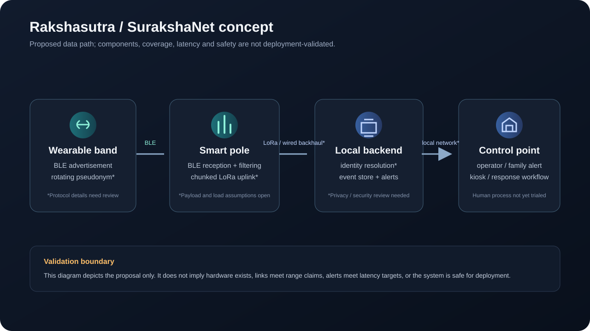
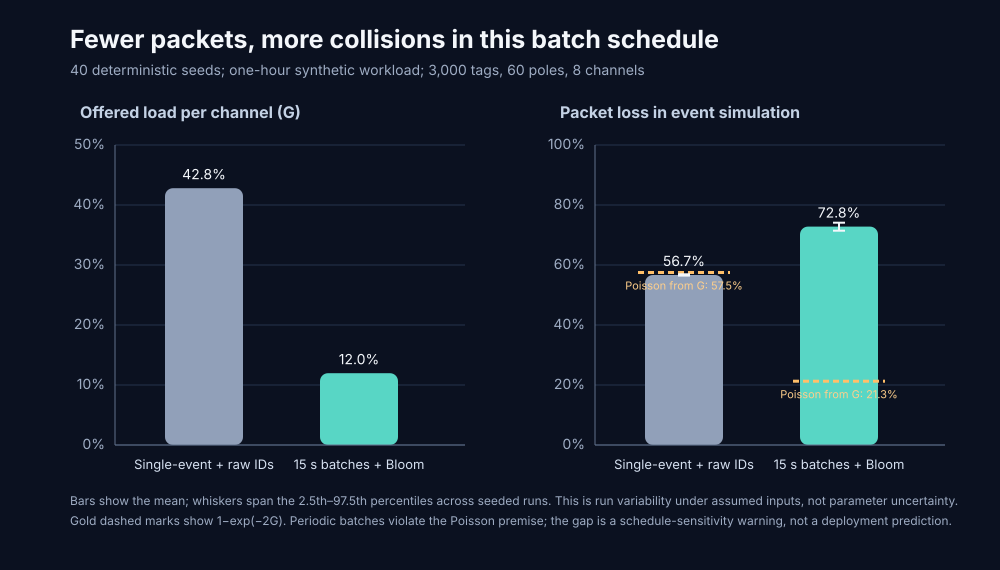

# Rakshasutra | SurakshaNet

**Research engineering workspace for an offline BLE-to-LoRaWAN pilgrim-safety concept.** This repository preserves the nine-page author-supplied manuscript and provides reproducible arithmetic checks and simulations for a subset of its claims.

> **Evidence status:** The manuscript describes an architecture and reports numerical outcomes, but no raw field dataset, hardware logs, deployment record, or experimental protocol was supplied with it. Values from the manuscript are therefore treated as *reported claims*, not independently verified results. The simulations here are analytical/synthetic and must not be described as field measurements or proof of safety or efficacy.



**Start here:** [claim audit](docs/claim-audit.md) · [reproduction guide](docs/reproduction.md) · [supplied paper](paper/rakshasutra_open.pdf) · [generated results](results/)

## What this project contains

- `paper/rakshasutra_open.pdf` — exact copy of the supplied nine-page PDF.
- `simulation/audit.py` — standard-library Python calculations for LoRa airtime, pure-ALOHA collision probability, Bloom-filter false positives, BLE single-hit capture assumptions, pseudonym collision probability, and idealized battery arithmetic.
- `simulation/traffic_simulation.py` — a fixed-seed, explicitly synthetic single-cell Poisson traffic comparison.
- `configs/traffic_scenario.json` — its editable scenario inputs and all traffic-model assumptions.
- `configs/claims.json` — inputs transcribed from the paper, with provenance and evidence status.
- `results/` — generated CSV tables from the audit script.
- `figures/` — generated SVG plots and a conceptual system diagram.
- `docs/claim-audit.md` — claim-by-claim limitations and technical issues to resolve before a preprint or deployment claim.
- `docs/reproduction.md` — exact commands and model definitions.

## Quick start

Requires Python 3.10 or later; the audit uses only the Python standard library.

```bash
python simulation/audit.py
python simulation/traffic_simulation.py
```

The command rewrites CSV outputs in `results/` and SVG figures in `figures/`. It uses fixed deterministic calculations. It does not model the full RF environment, LoRaWAN regional compliance, BLE receiver performance, human behavior, or a real shrine deployment.

## Headline checks

- The paper's SF7 airtime values for 28 B, 77 B, and 213 B PHY payloads can be reproduced from the standard LoRa symbol-time equation (under the paper's stated SF7/125 kHz assumptions).
- The packet-loss values in its comparison table are consistent with the pure-ALOHA relation `P_loss = 1 - exp(-2G)` when the listed offered load `G` is used. This checks the formula, not whether the offered load is derived from a realistic event trace.
- A 512-bit Bloom filter with three hashes has density-dependent false positives; it cannot provide a universal guarantee of exact tag identity or zero false reports.
- The stated average current of 29.74 µA implies ideal capacity/current lifetimes that differ from the paper's stated month figures. Real life must be established with a complete load profile and cold-temperature hardware tests.
- A claim such as 99.4% EV capture cannot be derived from “five opportunities” alone; the per-advertisement packet reception probability must be measured or otherwise justified.
- The 3000-tag comparison table's offered-load values imply a 77.9% drop from 39.0% to 8.6%; the abstract separately states an 82.4% airtime reduction, which needs reconciliation.
- The separate synthetic workload does not tune itself to the paper's 15.8% loss result; it uses the assumptions listed in `configs/traffic_scenario.json` and reports its own seeded outcome.



In this synthetic workload, periodic batch flushes cluster the transmissions. The event simulation therefore produces a much higher loss than the pure-ALOHA estimate from mean offered load alone. This is a schedule-sensitivity warning under the stated assumptions, not evidence of actual shrine-network performance.

See the audit notes before quoting any number from this repository.

## Safety, privacy, and intended use

This is a research prototype and calculation set. It is not a validated child-tracking product, medical device, emergency-response system, or safety-certified design. Do not deploy it for real-world safeguarding without institutional review, privacy/legal review, security testing, RF and battery testing, and operational trials. The uploaded source contains implementation proposals that need independent technical and regulatory review.

## Citation

Jha, Raj. *Rakshasutra: A Privacy-Preserving, Edge-Filtered Hybrid BLE–LoRaWAN Architecture for Real-Time Crowd Localization in Cellular-Denied Mountain Pilgrimages*. Author-supplied preprint, October 2026, 9 pages. This repository preserves the supplied PDF and audits selected calculations; it does not certify the manuscript's reported evaluations.

No license is included. All rights in the manuscript remain with its author unless a license is added explicitly.
